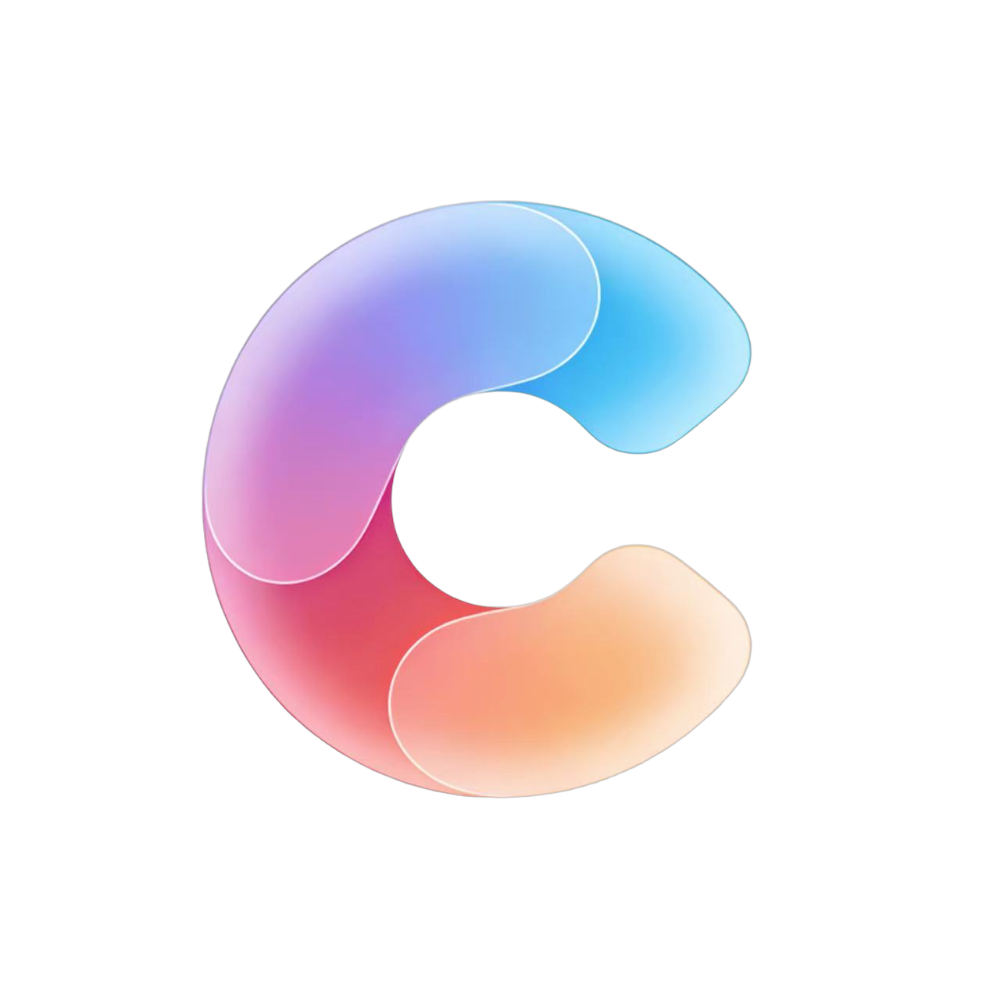
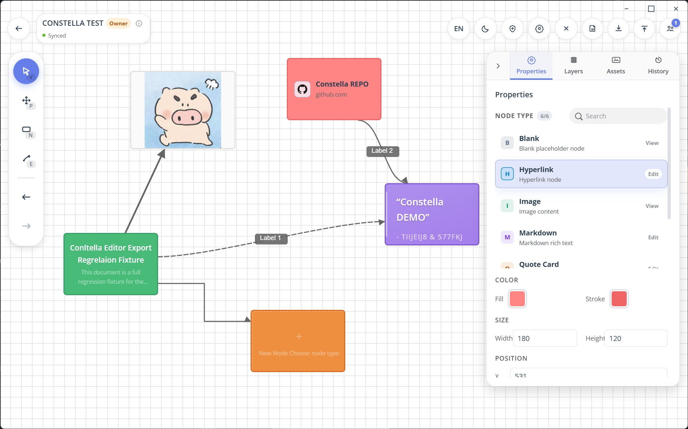
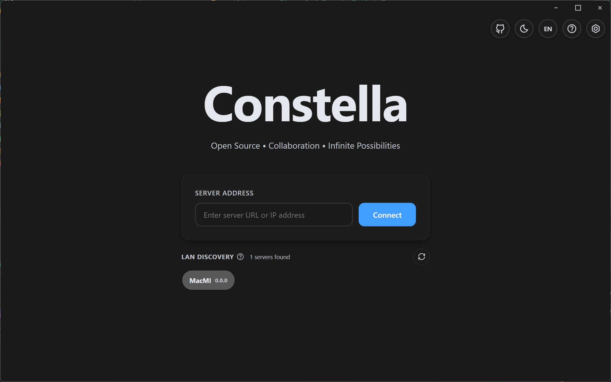
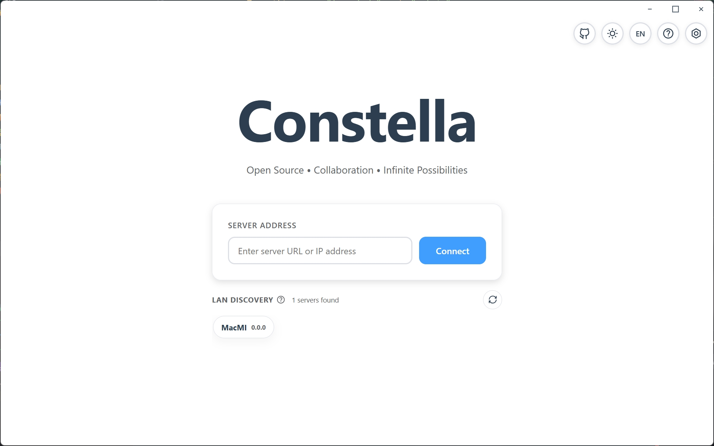
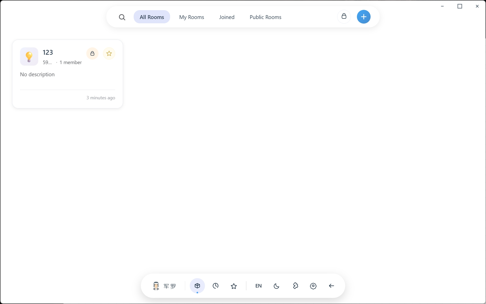
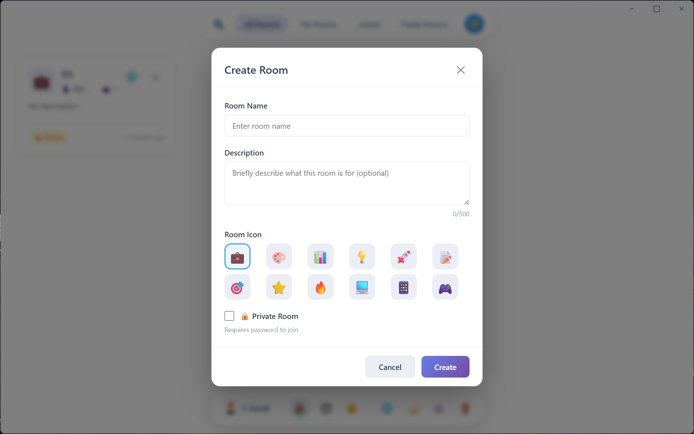
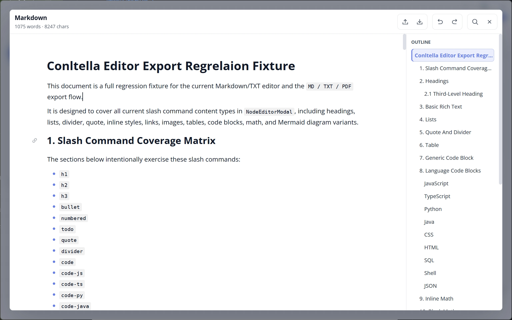
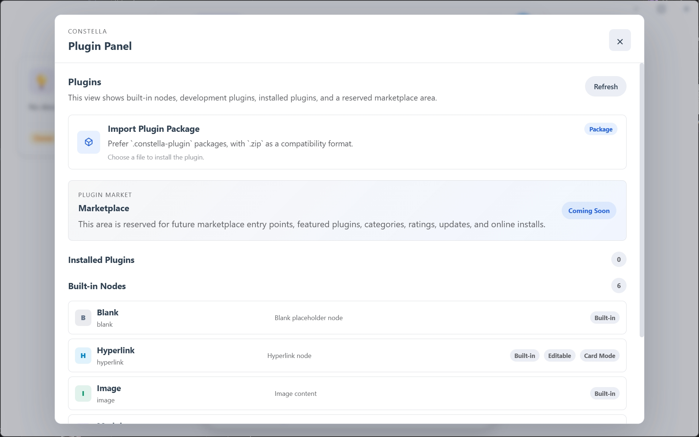
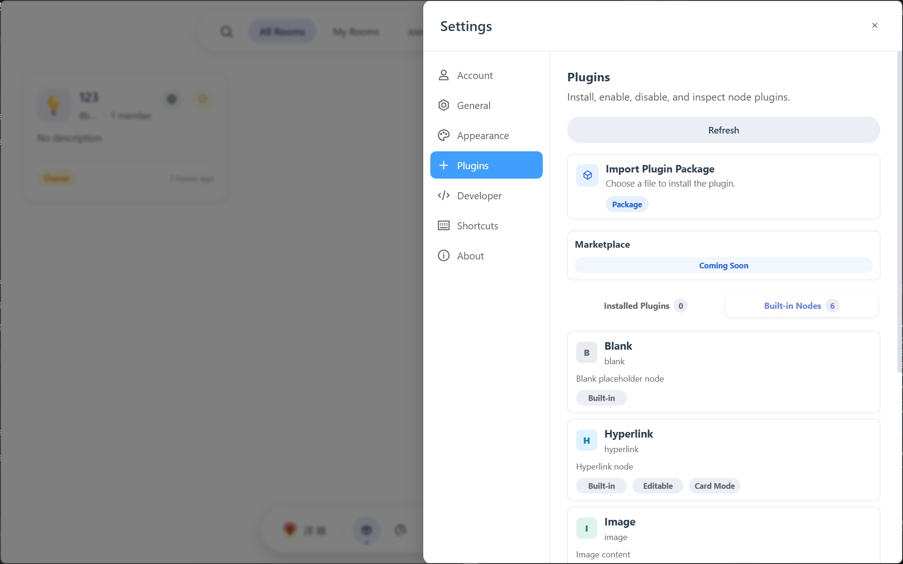
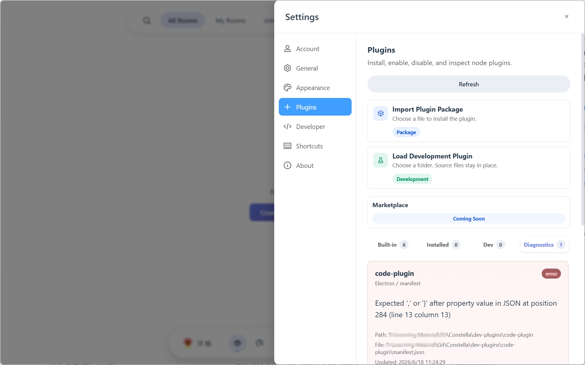

<div align="center">



# Constella

**面向知识结构化与协作式思维外化的实时协作无限画布**

Vue 3 · TypeScript · Vite · Electron · Yjs

[](https://github.com/TiiJeiJ8/constella/stargazers)
[](https://github.com/TiiJeiJ8/constella/forks)
[](https://github.com/TiiJeiJ8/constella/issues)
[](./LICENSE)

[快速开始](#快速开始) · [核心功能](#核心功能) · [界面展示](#界面展示) · [插件生态](#插件生态) · [参与贡献](#参与贡献)

[后端工程](https://github.com/TiiJeiJ8/Constella_CORE) · [问题反馈](https://github.com/TiiJeiJ8/constella/issues) · [EN README](README-en.md)

</div>



## 项目介绍

Constella 关注结构化思维表达，通过无限画布连接节点、内容与协作者，支持 Web 浏览器和 Electron 桌面端。

> [!IMPORTANT]
> 本仓库是 Constella 的前端工程（Web + Electron），后端请使用 [Constella_CORE](https://github.com/TiiJeiJ8/Constella_CORE)。
>
> 当前项目仍在持续迭代，欢迎通过 Issue 和 PR 参与改进。

> [!NOTE]
> **从源码开发或构建**需要安装 Node.js。
>
> **桌面发行版（installer / zip）**已内置 Node.js 环境，终端用户无需额外安装。

## 核心功能

| 功能 | 说明 |
| --- | --- |
| 无限画布 | 支持节点、连线、拖拽与缩放 |
| 实时协作 | 基于 CRDT（Yjs + y-websocket），实现多人同步编辑与状态共享 |
| 插件化节点 | 支持 Text、Markdown、Image、Hyperlink 等节点及节点插件导入 |
| 房间权限 | 区分成员角色，明确协作边界 |
| 国际化与主题 | 支持中英文切换、亮色与暗色主题 |
| 数据持久化 | Web 端使用 IndexedDB，桌面端使用 electron-store |

## 快速开始

### 环境准备

- Node.js **22.12.0**
- 后端服务：[Constella_CORE](https://github.com/TiiJeiJ8/Constella_CORE)

### 获取源码

```bash
git clone https://github.com/TiiJeiJ8/constella.git
```

进入前端工程的 `web` 目录后，安装依赖并启动：

```bash
npm install
npm run dev
```

首次启动后，在首页输入后端地址；该地址将持久化保存到本地。

### 常用命令

| 用途 | 命令 | 产物目录 |
| --- | --- | --- |
| 启动 Web 开发环境 | `npm run dev` | — |
| 启动 Electron 开发模式 | `npm run dev:electron` | — |
| 构建 Web 产物 | `npm run build` | `dist/` |
| 构建 Electron 客户端（包含内置 Node runtime） | `npm run build:electron` | `dist-electron/` |

## 构建与部署

### 构建桌面发行版

**1. 更新版本号（构建前必做）**

将 `1.x.x` 替换为目标版本号：

```bash
npm run version:bump -- 1.x.x
```

该命令会同步更新 `web/package.json` 与 `web/package-lock.json`，并尝试同步 `../server/package.json` 与 `../server/package-lock.json`。如果找不到 `server` 目录或后端版本文件，会自动跳过后端同步，不影响前端版本更新。

**2. 选择构建方式**

| 构建方式 | 命令 |
| --- | --- |
| 同时生成 installer 和 zip | `npm run build:electron:release` |
| 仅生成安装程序 | `npm run build:electron:installer` |
| 仅生成 zip | `npm run build:electron:zip` |

构建产物输出至 `dist-electron/`。

### Web 部署

运行 `npm run build` 后，可将 `dist/` 中的前端产物作为静态站点部署至 Nginx、Caddy 或其他静态托管平台。

后端服务的部署方式请参考 [Constella_CORE](https://github.com/TiiJeiJ8/Constella_CORE)。

### 协作地址配置

默认根据首页输入的后端地址自动推导 WebSocket 地址。如需手动指定，可在 `.env.development` 中配置：

```dotenv
VITE_WS_URL=localhost:3000
```

### 后端 JWT 密钥配置

| 使用场景 | 配置方式 |
| --- | --- |
| 打包分发版（Electron 应用） | 无需手动配置；首次启动时，后端自动生成随机密钥并保存到本地配置目录 |
| 自建部署 | 通过 `JWT_SECRET` 环境变量或配置文件指定密钥，详见[后端文档](https://github.com/TiiJeiJ8/Constella_CORE/blob/master/README.md) |

## 插件生态

Constella 同时支持内置节点插件与可安装运行时插件。

### 插件类型

| 类型 | 说明 |
| --- | --- |
| 内置正式插件 | 位于 `src/plugins/`，属于应用本身，随版本一起发布 |
| 用户安装插件 | 推荐使用 `.constella-plugin` 安装包，也兼容 `.zip` 格式 |
| 开发调试插件 | 开启 `Developer Mode` 后，可通过开发插件文件夹入口导入 |

建议按以上三类分别管理插件，保持目录职责清晰。

### 安装与持久化

- `manifest.json` 是插件目录的入口文件，不应作为独立安装包直接分发。
- 已安装插件会持久化到 Electron 用户数据目录，重启桌面应用后仍然存在：

  ```text
  app.getPath('userData')/plugins/installed
  ```

- 关闭 `Developer Mode` 后，开发插件入口会隐藏，开发插件也会停止在运行时加载；已有记录会保留，便于后续重用。

### 开发文档

- [插件安装包格式](docs/PLUGIN_PACKAGE_FORMAT.md)
- [插件开发架构 4.0](docs/PLUGIN_DEVELOPMENT_ARCHITECTURE_4.0.md)

## 界面展示

展开下方条目查看对应界面。

<details>
<summary><strong>主题切换 · 深色与浅色模式</strong></summary>

### 深色模式



### 浅色模式



</details>

<details>
<summary><strong>房间管理 · 房间页与创建房间</strong></summary>

### 房间页



### 创建房间



</details>

<details>
<summary><strong>画布编辑 · 编辑器演示</strong></summary>



</details>

<details>
<summary><strong>插件管理 · 插件面板与设置</strong></summary>

### 插件面板



### 插件设置



</details>

<details>
<summary><strong>插件开发 · 调试界面</strong></summary>



</details>

## 项目结构

```text
src/
├─ components/      # 通用 UI 组件
├─ plugins/         # 节点插件
├─ composables/     # 组合式逻辑
├─ services/        # API 与协作服务
├─ locales/         # 国际化资源
├─ views/           # 页面视图
└─ assets/          # 静态资源

electron/           # Electron 主进程与 preload
public/             # 公共资源
docs/               # 使用与开发文档
```

## 参与贡献

欢迎通过以下方式参与 Constella：

- **反馈问题**：提交 Issue，报告问题或提出建议。
- **改进项目**：提交 PR，完善功能、文档或测试。
- **支持项目**：通过 Star / Fork 支持项目长期迭代。

<a href="https://github.com/TiiJeiJ8/constella/graphs/contributors" target="_blank" rel="noopener">
  
</a>

## 免责声明

本项目处于持续开发阶段，部分功能和接口可能发生调整。请在生产环境使用前完成充分测试与风险评估。

## 开源许可

本项目采用 [MIT License](./LICENSE)。

### 第三方开源组件

Constella 的 Markdown 节点编辑器使用了基于 MarkText / Muya 的内部 fork。相关源码位于 `web/vendor/muya`，其原始 MIT License、NOTICE 与上游说明已保留在该目录中。

## Star History

<a href="https://www.star-history.com/?repos=TiiJeiJ8%2Fconstella&type=timeline&legend=bottom-right">
  <picture>
    <source media="(prefers-color-scheme: dark)" srcset="https://api.star-history.com/image?repos=TiiJeiJ8/constella&type=timeline&theme=dark&legend=bottom-right" />
    <source media="(prefers-color-scheme: light)" srcset="https://api.star-history.com/image?repos=TiiJeiJ8/constella&type=timeline&legend=bottom-right" />
    
  </picture>
</a>
